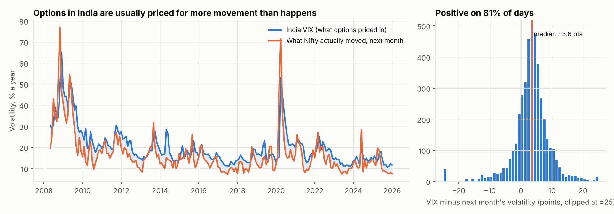
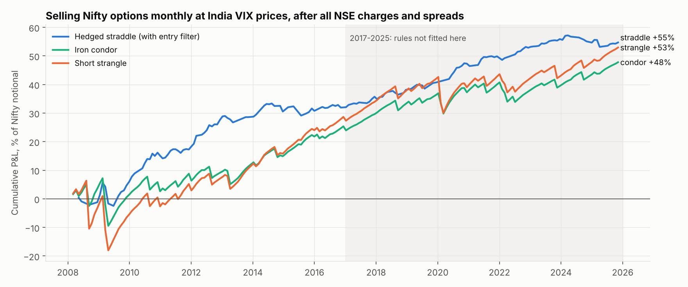

# NSE Quant Research

Quantitative finance research on Indian equities, built from scratch in Python
and tested the way a trading desk would test it. Every backtest:
- trades one day after its signal, so it never uses future data;
- pays real NSE charges (STT, stamp duty, exchange and SEBI fees, GST);
- is compared against buy and hold and a 6% risk-free rate;
- is re-checked on data it wasn't tuned on.

| Project | What it does | Headline result |
|---|---|---|
| [**quant-finance**](quant-finance/) | Monte Carlo Value at Risk, pairs trading (cointegration), moving-average trend following | The 99% VaR was breached **3.1%** of months, not 1%. **0 of 18** cointegrated pairs stayed cointegrated. The famous 50/200 crossover ranked **67th of 70** rules. |
| [**options-lab**](options-lab/) | Black-Scholes, binomial and Monte Carlo pricers, Greeks, implied volatility, delta hedging, and the **India volatility risk premium** study | India VIX priced in more movement than Nifty delivered on **81% of days** since 2008 (median **+3.6 vol points**, positive in **18 of 18 years**). A delta-hedged straddle rule chosen on 2008–16 earned a **Sharpe of 1.36 on 2017–25**, after NSE charges. |
| [**dashboard**](dashboard/) | Interactive page with a plain-English guide and how-to videos: trade planner (position sizing with NSE charges), option strategy builder, pricer and the volatility edge (with a 'check today' tool) | Live at **https://adityasawant0503.github.io/nse-quant-research/**. The JavaScript maths is checked against the Python. |





## Quick start

```bash
make setup        # create .venv and install both packages
make data         # download the Nifty datasets
make test         # 60 Python tests + 44 checks of the dashboard's JS (vs Python and hand-checked values)
make reproduce    # regenerate every figure and print every study
make serve        # dashboard at http://localhost:8000
```

Requires Python 3.11+ and, for the dashboard check, Node 18+.

## Engineering

- **Libraries, not notebooks.** `quantlab` and `optlab` are installable packages.
  The scripts in each `scripts/` folder are thin command-line wrappers around them.
- **Cross-validated maths.** Three option pricers check each other. Every Greek
  is checked against finite differences. VaR calibration and the one-day signal
  lag (no look-ahead) have their own tests.
- **Vectorised.** The 271-month hedging backtest runs as one NumPy array
  operation: about 200x faster than the per-month loop, with byte-identical output.
- **Verified port.** `dashboard/test_lib.mjs` checks the browser maths against
  reference values exported from Python.
- **Reproducible.** One CI workflow runs lint, both test suites, the data
  download and the JS-versus-Python check.

## Layout

```
quant-finance/   quantlab package · VaR, pairs, trend studies · figures · learning guide (docs/)
options-lab/     optlab package · pricers, Greeks, implied vol, hedging · Nifty backtest · figures
dashboard/       index.html + lib.js (no framework) · build_data.py · test_lib.mjs
RESUME.md        resume entries for this portfolio
INTERVIEW_GUIDE.md   every concept explained, numbers to remember, likely questions
```

## Data and limitations

- **Sources.** Nifty 50 index daily closes (2001-2023) and 50 Nifty 50 stocks
  (Oct 2020 - Sep 2025), from public GitHub datasets. They're downloaded by
  `make data`, not committed.
- **Option prices come from India VIX,** not historical option-chain prices, so
  the smile is approximated (a skew parameter) and bid-ask is an allowance.
- **Survivorship bias.** The stock universe is today's Nifty 50.
- **Not modelled.** Lot sizes, margin, futures roll and taxes.

Each project's README lists its own limitations. Educational research, not
investment advice.
